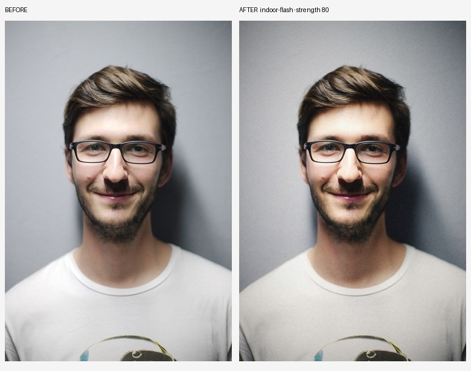

# CCD Photo Enhancer

[](https://github.com/long970/ccd-skill/actions/workflows/tests.yml)
[](https://github.com/long970/ccd-skill/releases)
[](LICENSE)

**Turn existing photos into a repeatable early compact-digital-camera look — locally, without uploads or generative reinterpretation.**

CCD Photo Enhancer is a local-first Agent Skill for CCD, Y2K and retro digicam styling. It provides four calibrated presets, deterministic Pillow/NumPy processing, single-image and folder workflows, and strict source-file protection. It is a visual approximation, not a physical simulation of a specific CCD sensor.

## Why this Skill

- **Private by design.** Photos are processed locally. The CLI makes no network requests and does not upload images.
- **Repeatable.** The same image, parameters, seed and dependency versions produce the same pixels.
- **Non-destructive.** Outputs are new files; existing files and source photos are never overwritten.
- **Useful at collection scale.** Batch mode processes a folder level and reports every success or failure.
- **Clear about its limits.** No face detection, semantic retouching, real flash-shadow reconstruction or claimed camera-model matching.

## At a Glance

| | |
|---|---|
| **Current release** | [v1.5.0](https://github.com/long970/ccd-skill/releases/tag/v1.5.0) |
| **Input** | Static JPEG, PNG and WebP |
| **Output** | New JPEG, PNG or WebP; orientation and dimensions preserved |
| **Presets** | `daylight-clean`, `daylight-aged`, `indoor-flash`, `night-flash` |
| **Workflows** | Single image, metric-only preview, non-recursive folder batch |
| **Runtime** | Python 3.12 with Pillow and NumPy |
| **Tested on** | Ubuntu and Windows through GitHub Actions |
| **License** | MIT |

## Install

### Requirements

- Python 3.12
- [Pillow and NumPy](requirements.txt)
- Node.js 22.20+ only when using the Skills CLI

The processor never installs dependencies. Install them explicitly:

```text
python -m pip install -r requirements.txt
```

### Skills CLI

Install the public GitHub bundle with:

```text
npx skills add long970/ccd-skill --skill ccd-photo-enhancer
```

The Skills CLI installs the Skill files; it does not install the Python runtime dependencies.

### Manual or archive install

Download `ccd-photo-enhancer.zip` from [GitHub Releases](https://github.com/long970/ccd-skill/releases/latest), extract it, and place the `ccd-photo-enhancer` directory in your agent's Skill directory. Alternatively, clone this repository and point the agent at `skills/ccd-photo-enhancer/`.

skills.sh is an external directory. Its website listing and audit metadata are updated asynchronously after the registry indexes this public repository; installation does not depend on the website page being present.

## Quick Start

The commands below use the repository layout. If the Skill is already installed, replace `skills/ccd-photo-enhancer/` with its installed directory.

```bash
# A clearly visible CCD treatment
python skills/ccd-photo-enhancer/scripts/apply_ccd.py photo.jpg \
  --preset daylight-aged --strength 75 --seed 0

# Indoor flash look with reduced grain
python skills/ccd-photo-enhancer/scripts/apply_ccd.py portrait.png \
  --preset indoor-flash --strength 75 --grain-strength 10 --out portrait-ccd.png
```

Every successful run prints a JSON report with the resolved output path, preset, strength, seed, dimensions, clipping metrics and warnings.

### Batch a folder

Create an output directory that is separate from the input directory, then run:

```bash
python skills/ccd-photo-enhancer/scripts/apply_ccd.py photos \
  --batch \
  --preset daylight-aged \
  --strength 75 \
  --seed 7 \
  --out ccd-output
```

Batch mode:

- reads only the first directory level;
- requires an existing `--out` directory different from the input directory;
- uses the explicit seed for each source image;
- emits one JSON summary with every per-image report;
- never writes generated files back into the source directory.

| Exit code | Meaning |
|---:|---|
| `0` | Every photo was processed |
| `1` | Some photos were processed; failures are listed per image |
| `2` | No photo was processed |

Batch mode does not support `--preview`. Preview one representative image first.

### Preview without writing

```bash
python skills/ccd-photo-enhancer/scripts/apply_ccd.py photo.jpg \
  --preset night-flash --strength 50 --preview
```

`--preview` returns in-memory metrics and writes no image. Metrics are measured before JPEG encoding and do not replace viewing the saved result.

## Presets

| Preset | Look | Best for |
|---|---|---|
| `daylight-clean` | Light digital saturation, gentle S-curve, subtle grain and vignette | Daylight portraits, streets, travel |
| `daylight-aged` | Warmer daylight colour, compressed highlights, visible grain and vignette | “Old digital camera” or lightly aged photos |
| `indoor-flash` | Centre-weighted lift, darker edges, warm highlight bloom and visible grain | Indoor parties and close-range snapshots |
| `night-flash` | Cool shadows, warm highlights, strong vignette, grain and deep blacks | Photos that are already shot at night |

The CLI default is strength `50`, which remains intentionally restrained and backwards-compatible. Start at **75–85** when the preset character should be obvious on first viewing. Inspect portraits for warmer skin and deeper shadows at high strength.

Individual sub-effects can be adjusted with `--grain-strength`, `--color-strength`, `--vignette-strength` and `--sharpness-strength`.

## Samples

Real photographs processed with the shipped CLI at `--seed 7`. Each image shows the source on the left and the result on the right. Sources and licensing: [docs/samples/README.md](docs/samples/README.md).




Strength ladder on the same portrait at 50 / 75 / 100:


Per-pixel grain disappears when a 1600 px photo is scaled down for a web page. This is the same indoor portrait at a 100% crop:


The samples demonstrate the shipped pipeline on real photos. They do not prove that the result matches a particular CCD model.

### Real-photo evaluation

The offline evaluation covers 15 licensed photographs and 30 runs at restrained and recommended strengths, including low-key and high-key portraits, groups, indoor events, backlight, landscapes, neon and rainy nights. The licensed source files are not committed to this repository; place them at the paths in `tests/real-photo-manifest.json` before running the offline evaluator.

```text
python tests/real_photo_eval.py
```

Results are recorded in the [30-run overview](docs/samples/real-evaluation-overview.jpg) and [JSON report](docs/samples/real-evaluation.json). The current mean absolute pixel change is 11.1/255, with a maximum post-processing near-white ratio of 0.12%. These are technical alerts, not proof of CCD authenticity or aesthetic quality.

## How It Works

The default path is **L2 local deterministic pixel processing**: colour curves, highlight roll-off, halation, flash falloff, black-point adjustment, vignette, grain and sharpening. The script does not use a generative model, move objects, crop or resize.

The Skill also has two non-default routes:

- **L1 generative editing** for semantic or medium-changing work such as ink painting, only when an authorized editor is available.
- **L3 prompt-only fallback** when no suitable local or generative backend exists. No image is changed in this route.

CCD presets always use the local pixel pipeline.

## Privacy and Safety

- No network access and no image uploads in the local pipeline.
- EXIF/GPS metadata is not copied to outputs.
- Inputs are never overwritten; existing output names receive a numbered suffix.
- Output dimensions and display orientation are preserved.
- Transparent inputs stay transparent; flattening to JPEG without consent is rejected.
- Failed output verification removes the incomplete file created by that run.
- Unsupported formats, corrupt ICC profiles and over-limit images fail explicitly instead of being guessed or silently resized.

### Supported limits

- Static JPEG, PNG and WebP only.
- HEIC/HEIF must be exported locally to a supported format first.
- Animation, floating-point rasters and unsupported ICC profiles fail explicitly.
- The default pixel ceiling is 60 MP and can be lowered with `--max-pixels`; images above the limit are not automatically resized.
- JPEG output uses quality 94, 4:4:4 chroma sampling and `optimize=False`.

## Reproducibility

The JSON report records the parameters, seed, dependency versions, orientation-corrected size, output format, clipping metrics and warnings. Identical input, parameters, seed and library versions are reproducible for the same image dimensions. Cross-version byte output may differ, and pixel-sized grain changes apparent size when the image is resized.

## Verification

```text
python -m unittest discover -s tests -v
```

- 38 automated tests cover orientation and EXIF removal, alpha preservation, deterministic output, clipping bounds, preset separation, batch safety and CLI failure reporting.
- GitHub Actions runs the suite on Ubuntu and Windows with Python 3.12.
- Release 1.5.0 was installed from the public GitHub repository with the Skills CLI and checked against the bundled files.

## Repository Layout

```text
skills/ccd-photo-enhancer/
  SKILL.md                 Agent routing and output contract
  VERSION                  Current bundle version
  scripts/apply_ccd.py     Local deterministic CLI
  references/              Presets, pipeline rules, artistic routes and tests
tests/
  test_apply_ccd.py        Automated unit tests
  real_photo_eval.py       Offline real-photo evaluation
  real-photo-manifest.json Evaluation sources and licensing
docs/samples/              Before/after examples and evaluation output
.github/workflows/         Ubuntu and Windows CI
```

## Versioning and Support

This project follows Semantic Versioning. See [CHANGELOG.md](CHANGELOG.md) for release notes and [GitHub Issues](https://github.com/long970/ccd-skill/issues) for bug reports and feature requests.

## Design References

The structure adapts ideas from related public Skills without copying their provider-specific APIs or implementation code:

- [Meitu image-style-transfer](https://www.skills.sh/meitu/meitu-skills/image-style-transfer): separate single-image presets from reference-guided style transfer.
- [Local Photo Filters](https://www.skills.sh/wendy7756/awesome-photo-filters/local-photo-filters): filter catalog, intensity controls and source preservation.
- [Eachlabs style-transfer](https://www.skills.sh/eachlabs/skills/style-transfer): preserve composition and identity while varying effect strength.
- [Openfilm vintage-film](https://www.skills.sh/openfilm/skills/vintage-film): protect people and moments; do not invent dates or source metadata.
- [Analog Memory Photo Director](https://www.skills.sh/chinelee/chinese-visual-director-skills/analog-memory-photo-director): build nostalgia from camera-era limitations rather than a sepia overlay alone.
- [Aesthetic Atelier](https://github.com/wzj52501/aesthetic-atelier): keep the core workflow concise and load recipes only when needed.

## License

[MIT](LICENSE) © 2026 CCD Photo Enhancer contributors
