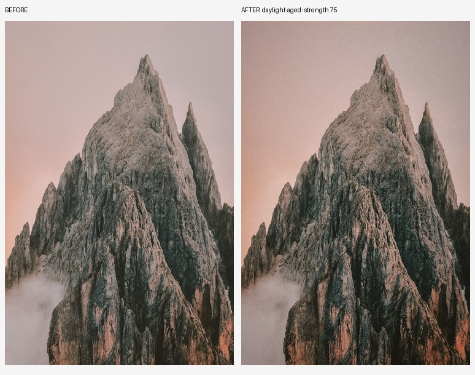
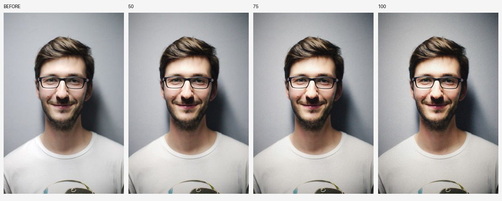

# CCD Photo Enhancer

A local-first Agent Skill for editing an existing photo with a repeatable early compact-digital-camera (CCD-look) treatment. The repository keeps the discoverable skill bundle under `skills/ccd-photo-enhancer/`; tests and release metadata live at the repository root.

## Repository layout

```text
skills/ccd-photo-enhancer/
  SKILL.md
  VERSION
  references/
  scripts/apply_ccd.py
tests/test_apply_ccd.py
.github/workflows/tests.yml
LICENSE
CHANGELOG.md
requirements.txt
```

The skill separates three capability levels: local deterministic pixel processing for CCD effects (L2), an explicitly available and authorized generative image-edit backend for semantic/medium changes such as ink painting (L1), and prompt-only fallback (L3). It does not claim that pixel filters reproduce a particular sensor or reconstruct real flash shadows.

## Samples

Real photographs, processed by the shipped CLI with `--seed 7`. Left is the unmodified photo, right is the result. Sources and licensing: [docs/samples/README.md](docs/samples/README.md).





Strength semantics on the same portrait (50 / 75 / 100). The default 50 is visible but restrained; 75-85 is where the preset character is obvious:



Grain and highlight bloom are per-pixel effects, so they disappear when a 1600 px photo is scaled down for a web page. This is the same indoor portrait at 100% crop:


These show the pipeline working on real photos. They do not prove the look matches a specific CCD model. Known limitation: warm highlight gains still shift light skin warmer at high strength, and L2 has no face or skin detection, so portrait output needs a visual check.

## Run the local CCD processor

The CLI requires Python, Pillow, and NumPy in the chosen interpreter. It never installs dependencies or accesses the network.

```text
python skills/ccd-photo-enhancer/scripts/apply_ccd.py photo.jpg --preset daylight-aged --strength 50 --seed 0
python skills/ccd-photo-enhancer/scripts/apply_ccd.py portrait.png --preset indoor-flash --strength 65 --grain-strength 10 --out portrait-ccd.png
python skills/ccd-photo-enhancer/scripts/apply_ccd.py photo.jpg --preset night-flash --strength 50 --preview
```

`--preview` reports in-memory pixel metrics and never writes an image; those metrics are measured before JPEG encoding and are not a substitute for viewing the saved result.

The CLI prints a JSON report on success and writes errors to stderr with a non-zero exit. It never overwrites an existing file; collisions receive a numbered suffix. PNG inputs and alpha-bearing images default to PNG; opaque JPEG/WebP inputs default to JPEG. JPEG uses quality 94, 4:4:4 chroma sampling, and `optimize=False` to avoid encoder failures on high-entropy content; output sizes vary by image. EXIF/GPS metadata is not copied. HEIC/HEIF, animation, unsupported ICC profiles, and floating-point rasters fail explicitly. The default pixel cap is 60MP; `--max-pixels` can be set from 1 to 60MP, with no automatic resizing.

## Tests and CI

```text
python -m unittest discover -s tests -v
```

The tests use `os.makedirs`-created unique child directories. They prefer `tests/.test-work` or `CCD_TEST_TMP`; if neither is writable, they fall back to `LOCALAPPDATA`, `TEMP`, or `TMP` and print the chosen path. They do not rely on `tempfile`'s private temporary-directory ACLs.

GitHub Actions runs the same suite on Windows and Ubuntu with the pinned dependencies in `requirements.txt`. The preset separation, dark vignette, and highlight assertions use generated calibration and photo-like fixtures. Measured with grain disabled: closest preset pair is ~1.6–1.8/255 at strength 50 and ≥2.4/255 at strength 80, so the documented "obvious preset character" applies from about strength 70 upward. **No real-photo before/after proof is included yet**: it must be added using an authorized sample photo and visually reviewed; synthetic charts are not a substitute.

## Install in DeepSeek Harness

The skill manifest slug is `ccd-photo-enhancer`. Copy only `skills/ccd-photo-enhancer/` as a one-level child of the user skill root, for example:

```powershell
Copy-Item -Recurse 'C:\work\ccd-skill\skills\ccd-photo-enhancer' 'C:\Users\user\.dsh\skills\ccd-photo-enhancer'
```

For skills.sh, after publishing this repository to a public GitHub location, install with `npx skills add <owner>/<repo> --skill ccd-photo-enhancer`. This workspace now has a local git repository with an initial commit, but **no remote is configured and nothing has been pushed**, so no marketplace listing, install count, or audit badge exists yet.

## Design references

The structure adapts ideas from related public skills without copying their provider-specific APIs or implementation code:

- [Meitu image-style-transfer](https://www.skills.sh/meitu/meitu-skills/image-style-transfer): separate single-image presets from reference-guided style transfer.
- [Local Photo Filters](https://www.skills.sh/wendy7756/awesome-photo-filters/local-photo-filters): filter catalog, intensity controls, and source preservation.
- [Eachlabs style-transfer](https://www.skills.sh/eachlabs/skills/style-transfer): preserve composition and identity while varying effect strength.
- [Openfilm vintage-film](https://www.skills.sh/openfilm/skills/vintage-film): protect people and moments; do not invent dates or source metadata.
- [Analog Memory Photo Director](https://www.skills.sh/chinelee/chinese-visual-director-skills/analog-memory-photo-director): build nostalgia from camera-era limitations rather than a sepia overlay alone.
- [Aesthetic Atelier](https://github.com/wzj52501/aesthetic-atelier): keep the core workflow concise and load recipes and regression guidance only when needed.
